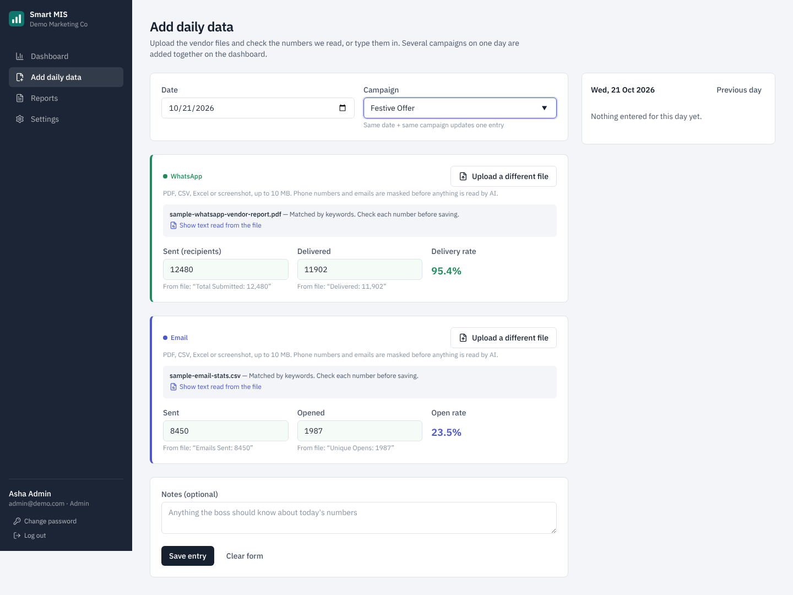
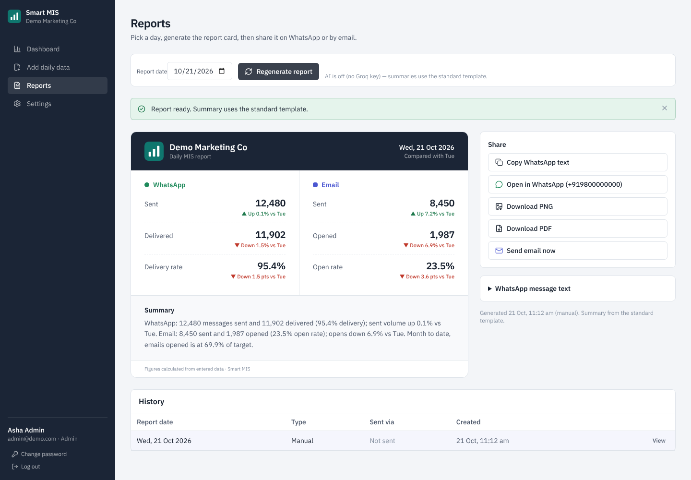
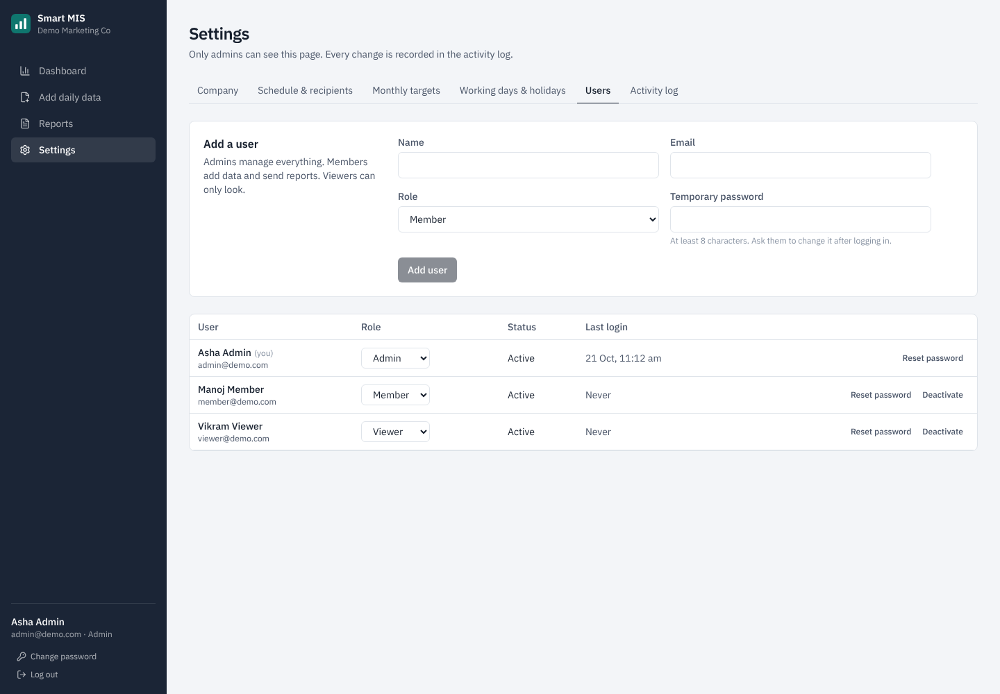
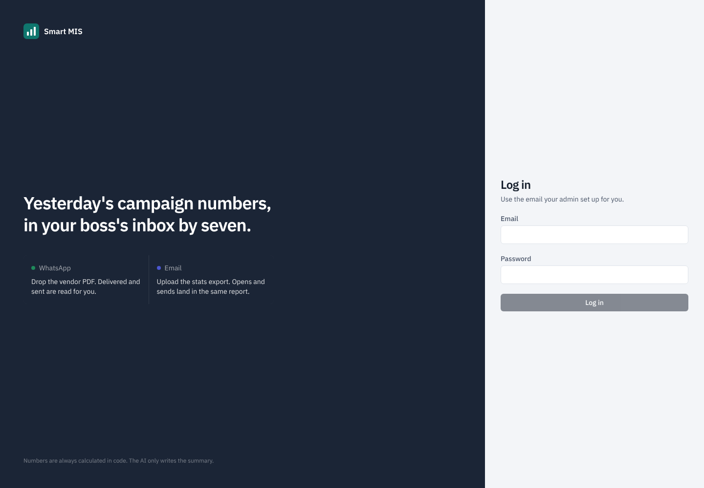
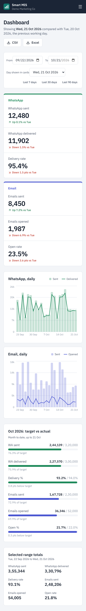

# Smart MIS

Automated daily MIS reports for teams that run promotional **WhatsApp** and **email** campaigns.

Today the daily report is manual: open the vendor PDF and the email stats, copy numbers, type a WhatsApp message to the boss. Smart MIS does it for you:

**upload files → numbers are extracted → dashboard → daily report with an AI summary → email / WhatsApp**

Everything runs on free tools. No paid service is required.

---

## Features

- **Add daily data** — upload the WhatsApp vendor report and the email stats (PDF, CSV, Excel or screenshot). The numbers are read for you and shown in editable fields, each with the exact line from the file it came from. Confirm, then save. Manual entry always works.
  - Per-recipient exports (one row per message) are **counted exactly in code**.
  - Other files: phone numbers and emails are **masked first**, then Groq AI reads the counts. Every AI value is checked against the quoted line; anything that doesn't match is discarded. With no AI key, keyword matching is used.
  - Same date + same campaign → "Update existing entry?" instead of a duplicate.
- **MIS dashboard** — 6 KPI cards (WA sent, delivered, delivery %, emails sent, opened, open %) with the change vs the previous working day as an arrow **and** words ("Up 12% vs Tue"), 30-day trend charts for both channels, monthly target-vs-actual bars, date range filter, CSV/Excel export, and a reminder banner when today's data is missing after the reminder time.
- **Reports** — branded report card (company name/logo, date, KPIs, 3–4 line AI summary). Copy WhatsApp text, open in WhatsApp (`wa.me`), download PNG / PDF, send email now. Report history.
- **Automatic sending** — on working days at the set time (default 19:00 Asia/Kolkata) the report is built and emailed. If no data was entered, admins get a "data missing" email instead.
- **Settings (admin)** — company name and logo, monthly targets, holidays, working-day rules, send/reminder times, recipients, users and roles, activity log.
- **Multi-company from day 1** — every table has `company_id`; every query is scoped to the logged-in user's company on the server.
- **Roles** — `admin` (everything), `member` (add/edit/delete data, generate and send reports), `viewer` (view only).

### The AI never makes up numbers

All KPIs and percentages are calculated in code. The AI only writes the summary sentences from the numbers it is given. After it answers, every number in the summary is checked against those numbers. If any number doesn't match, it is asked once more; if it still doesn't match, a fixed template is used.

## Screenshots

All data shown is fake demo data.

| Dashboard | Add daily data |
|---|---|
|  |  |

| Report card | Settings |
|---|---|
|  |  |

| Login | Mobile |
|---|---|
|  |  |

## Tech stack (zero cost)

| Part | Tool |
|---|---|
| Frontend | React + Vite + Tailwind CSS, Recharts, html-to-image, jsPDF |
| Backend | Node.js + Express 5 (TypeScript) |
| Database | SQLite via Prisma 7 (driver adapter `better-sqlite3`) — easy to move to Postgres |
| AI | Groq API free tier — text `openai/gpt-oss-120b`, vision `qwen/qwen3.8-27b`, with fallback lists |
| Files | `pdf-parse` (PDF), `papaparse` (CSV), `exceljs` (Excel) |
| Scheduling | `node-cron` inside the backend (no n8n needed) |
| Email | Nodemailer + Gmail SMTP (app password) |
| WhatsApp | Message text + `wa.me` link + Copy button; optional WhatsApp Cloud API sender (off unless configured) |
| Auth | Email + password, bcrypt, JWT in an httpOnly cookie |

## Quick start (local)

Requirements: **Node.js 20.19+** (22 LTS recommended) and npm.

```bash
git clone https://github.com/Abhi-ingole/smart-mis.git
cd smart-mis
cp .env.example .env        # then edit .env (see below)
npm install
npm run seed                # creates the database and demo data
npm run dev                 # API on :4000, app on http://localhost:5173
```

Open http://localhost:5173 and log in with a demo account (development only):

| Email | Role | Password |
|---|---|---|
| admin@demo.com | admin | `Demo@123` |
| member@demo.com | member | `Demo@123` |
| viewer@demo.com | viewer | `Demo@123` |

Try the upload flow with the fake files in [`samples/`](samples/).

### Scripts

| Command | What it does |
|---|---|
| `npm run dev` | Runs the API (with reload) and the Vite app together |
| `npm run seed` | Applies migrations, then seeds the demo company (refuses in production) |
| `npm run migrate` | Applies database migrations only |
| `npm test` | Runs the test suite |
| `npm run build` | Builds the client and the server |
| `npm start` | Starts the production server (serves the built app too) |

## Environment variables

Copy `.env.example` to `.env` in the project root. Never commit `.env`.

| Variable | Required | Description |
|---|---|---|
| `NODE_ENV` | yes | `development` or `production` |
| `PORT` | no | API port (default `4000`) |
| `APP_ORIGIN` | yes | The URL people open, e.g. `https://mis.yourdomain.com`. Only this origin is allowed by CORS. Dev: `http://localhost:5173` |
| `JWT_SECRET` | yes | Random string, **at least 32 characters**. The server refuses to start in production without it |
| `DATABASE_URL` | no | SQLite file, default `file:./data/smart-mis.db` (relative to `/server`) |
| `UPLOAD_DIR`, `BACKUP_DIR`, `BACKUP_KEEP` | no | Uploads folder, backups folder, number of backups kept (default 14) |
| `GROQ_API_KEY` | no | Free Groq key. Leave empty to run without AI |
| `GROQ_TEXT_MODELS` | no | Comma-separated; first is tried first, the rest are fallbacks |
| `GROQ_VISION_MODELS` | no | Same, for screenshots |
| `GMAIL_USER`, `GMAIL_APP_PASSWORD` | for email | Gmail address and its 16-character app password |
| `MAIL_FROM_NAME` | no | Display name on emails |
| `EMAIL_DRY_RUN` | no | `true` logs emails to the console instead of sending |
| `WA_CLOUD_TOKEN`, `WA_CLOUD_PHONE_NUMBER_ID`, `WA_CLOUD_API_VERSION` | no | Optional WhatsApp Cloud API. Disabled unless both token and phone number ID are set |
| `COOKIE_SECURE` | no | Defaults to `true` in production (HTTPS-only cookies). Only set `false` for a quick test over plain http |
| `ENABLE_CRON` | no | `false` turns off auto-send and backups |
| `TRUST_PROXY` | no | Number of proxies in front (default `1` in production, for Nginx) |

Generate a secret:

```bash
node -e "console.log(require('crypto').randomBytes(48).toString('hex'))"
```

### Get a free Groq API key

1. Go to https://console.groq.com and sign up (free).
2. Open **API Keys** → **Create API Key**, copy it.
3. Put it in `.env` as `GROQ_API_KEY=...` and restart the server.

Free-tier limits apply. If a model is unavailable or rate-limited, the next model in the list is tried; if all fail, extraction falls back to keyword matching and the summary to the template — the app keeps working.

### Get a Gmail app password

1. Turn on **2-Step Verification** for the Gmail account: https://myaccount.google.com/security
2. Open https://myaccount.google.com/apppasswords, create an app password named "Smart MIS".
3. Put the Gmail address in `GMAIL_USER` and the 16-character password (no spaces) in `GMAIL_APP_PASSWORD`.
4. In the app: **Settings → Schedule & recipients**, add recipients and click **Send a test email**.

Gmail allows roughly 500 emails a day from a personal account — plenty for a daily report.

### WhatsApp

The free route is built in: the Reports page gives you the formatted message, a **Copy** button and **Open in WhatsApp** links (`wa.me`) for each saved number.

Optional automatic sending uses Meta's **WhatsApp Cloud API**. Set `WA_CLOUD_TOKEN` and `WA_CLOUD_PHONE_NUMBER_ID` to enable the "Send via WhatsApp API" button. Note: Meta only delivers free-form text inside a 24-hour window after the recipient last messaged your business number; outside it you need an approved template message.

## Deploy on an Ubuntu VPS (PM2 + Nginx)

Tested layout: Ubuntu 22.04/24.04, a domain pointing at the server (e.g. `mis.yourdomain.com`).

```bash
# 1. System packages
sudo apt update && sudo apt -y upgrade
sudo apt -y install nginx git build-essential python3
curl -fsSL https://deb.nodesource.com/setup_22.x | sudo -E bash -
sudo apt -y install nodejs
sudo npm install -g pm2

# 2. Get the code (as a normal user, not root)
git clone https://github.com/Abhi-ingole/smart-mis.git
cd smart-mis
cp .env.example .env
nano .env     # NODE_ENV=production, APP_ORIGIN=https://mis.yourdomain.com, JWT_SECRET, Groq, Gmail

# 3. Install, build, create the database
npm ci
npm run build
npm run migrate
# Production has no demo users. Create your first admin:
npm run create-admin -- --email you@company.com --name "Your Name" --company "Your Company"

# 4. Run with PM2 (restarts on crash and on reboot)
pm2 start ecosystem.config.cjs
pm2 save
pm2 startup     # run the command it prints

# 5. Nginx reverse proxy
sudo cp deploy/nginx.conf /etc/nginx/sites-available/smart-mis
sudo nano /etc/nginx/sites-available/smart-mis      # set server_name
sudo ln -s /etc/nginx/sites-available/smart-mis /etc/nginx/sites-enabled/
sudo rm -f /etc/nginx/sites-enabled/default
sudo nginx -t && sudo systemctl reload nginx
```

Then add HTTPS (see Security below). Updating later:

```bash
git pull && npm ci && npm run build && npm run migrate && pm2 restart smart-mis
```

Keep a single PM2 instance: SQLite and the built-in scheduler expect one process.

## Docker option

```bash
cp .env.example .env    # set NODE_ENV=production, APP_ORIGIN, JWT_SECRET, ...
docker compose up -d --build
docker compose exec smart-mis node dist/scripts/create-admin.js --email you@company.com --name "Your Name" --company "Your Company"
```

The app listens on `127.0.0.1:4000`; put Nginx with HTTPS in front as above. The database, uploads and backups live in Docker volumes (`smis-data`, `smis-uploads`, `smis-backups`). Migrations run automatically on start.

## Security

What the app does:

- Secrets only in `.env` (never in frontend code or Git). `.env.example` has placeholders only.
- Passwords hashed with bcrypt (cost 12), minimum 8 characters.
- Session JWT in an `httpOnly`, `SameSite=Strict`, `Secure` (production) cookie; 8-hour expiry. Changing a password, role or deactivating a user ends their other sessions.
- CSRF protection on every POST/PUT/PATCH/DELETE: signed double-submit token + SameSite=Strict cookies + an origin check.
- Login rate limit per IP, and account lockout for 15 minutes after 5 failed attempts.
- Helmet security headers with a strict Content-Security-Policy; strict CORS (only `APP_ORIGIN`).
- Every request body, query and route param validated with zod.
- Roles **and** company are checked on the server for every API route; the UI is never trusted.
- Uploads: max 10 MB; only PDF, CSV, XLSX, PNG, JPG; extension, MIME type **and** file signature must agree; saved with random names in `server/uploads` (outside any public folder); downloadable only by logged-in users of the same company.
- Phone numbers and emails are masked before any text goes to the AI. Screenshots can't be masked that way, so sending them to AI is **off by default** (Settings → Company).
- Audit log of logins, failed logins, lockouts and every create/update/delete (who, what, when, IP). Passwords, tokens and keys are never logged.
- Nightly SQLite backup at 23:00 (Asia/Kolkata) to `server/backups`, keeping the last 14.
- No stack traces in production error responses. Refuses to start in production without a strong `JWT_SECRET`. Demo users are only created outside production.

What you should do on the server:

1. **HTTPS with Let's Encrypt (Certbot)**
   ```bash
   sudo apt -y install certbot python3-certbot-nginx
   sudo certbot --nginx -d mis.yourdomain.com
   sudo certbot renew --dry-run      # auto-renewal check
   ```
2. **Firewall (UFW) — allow only SSH, HTTP and HTTPS**
   ```bash
   sudo ufw default deny incoming
   sudo ufw default allow outgoing
   sudo ufw allow 22/tcp
   sudo ufw allow 80/tcp
   sudo ufw allow 443/tcp
   sudo ufw enable
   sudo ufw status
   ```
   Port 4000 stays closed; only Nginx talks to the app.
3. **Change demo passwords.** Demo users are never created in production. If you ever ran `npm run seed` on a server, delete or reset those accounts in **Settings → Users** and use **Change password** for your own account.
4. **Backups.** Copy `server/backups/` off the server regularly (e.g. `rsync` to another machine or cloud storage). To restore: stop the app, copy a backup over `server/data/smart-mis.db`, start the app.
5. **Run `npm audit` before each deploy** and fix high/critical issues:
   ```bash
   npm audit
   npm audit fix
   ```
6. Keep the OS updated (`sudo apt update && sudo apt upgrade`), use SSH keys instead of passwords, and keep `.env` readable only by the app user (`chmod 600 .env`).

## Moving to Postgres later

1. In `server/prisma/schema.prisma` change `provider = "sqlite"` to `"postgresql"`.
2. `npm i -w server @prisma/adapter-pg pg` and swap `PrismaBetterSqlite3` for `PrismaPg` in `server/src/lib/db.ts`.
3. Set `DATABASE_URL=postgresql://...` and run `npx prisma migrate dev --name init` inside `/server`.
4. Replace the SQLite backup job with `pg_dump`.

## Project structure

```
smart-mis/
├─ client/                 React + Vite + Tailwind app
│  └─ src/pages/           Login, Dashboard, AddData, Reports, Settings, ChangePassword
├─ server/
│  ├─ prisma/              schema.prisma + SQL migrations
│  ├─ src/
│  │  ├─ routes/           auth, metrics, extract/files, dashboard, reports, settings
│  │  ├─ middleware/       auth/roles/CSRF, zod validation, errors
│  │  ├─ services/         extraction, KPIs, reports, AI summary, mail, WhatsApp
│  │  ├─ jobs/             scheduler (auto-send) and backups
│  │  ├─ lib/              config, dates, working days, KPI maths, masking, file checks
│  │  └─ scripts/          migrate, seed, create-admin, sample files
│  └─ test/                Vitest + Supertest
├─ samples/                Fake vendor files for trying the upload flow
├─ deploy/nginx.conf
├─ Dockerfile, docker-compose.yml, ecosystem.config.cjs
└─ .env.example
```

## Troubleshooting

- **`prisma generate` fails downloading engines** (very restricted networks): Prisma needs a one-time download from `binaries.prisma.sh`. Allow that host, or set `PRISMA_ENGINES_CHECKSUM_IGNORE_MISSING=1`. The app itself runs migrations with its own runner and doesn't need the engine at runtime.
- **Logged out immediately in production over http** — cookies are HTTPS-only in production. Set up HTTPS (recommended) or, for a short test only, `COOKIE_SECURE=false`.
- **"Invalid CSRF token"** — refresh the page; make sure `APP_ORIGIN` exactly matches the URL in the browser (scheme, domain, port).
- **Emails not sending** — check `GMAIL_USER`/`GMAIL_APP_PASSWORD`, then use **Send a test email** in Settings and watch the server log.
