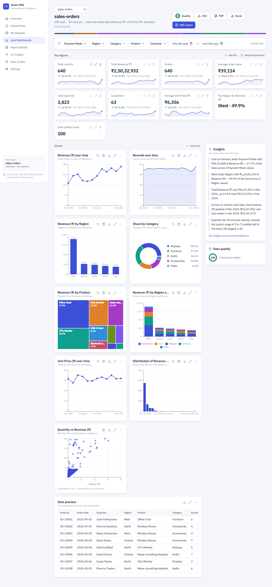
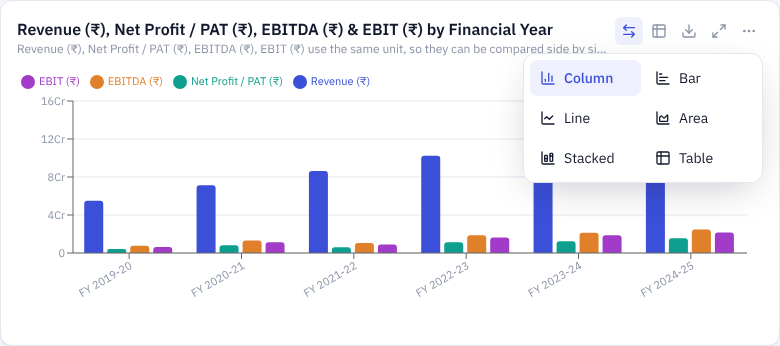

# Smart MIS — universal spreadsheet intelligence

Upload **any** Excel or CSV file and get, automatically:

- column type detection (numbers, money, percentages, dates, categories, IDs…)
- a data-quality score with clear warnings (missing values, duplicates, invalid values, outliers)
- KPIs chosen for *your* columns — each with its value, formula and source columns
- an interactive dashboard with sensible charts and filters
- evidence-backed insights, kept separate from recommendations
- a professional MIS report you can export to **PDF**, **Excel** or **CSV**, or print

It adapts to the data: sales files get revenue and order KPIs, HR files get headcount and attrition, marks sheets get averages and pass rates, and unknown data gets honest descriptive statistics. Nothing is hard-coded per industry, and no number is ever invented.

> **Privacy:** files are parsed and stored **in your browser** (IndexedDB). Nothing is uploaded. AI is optional, off by default, and only ever receives computed summary statistics after you tick a consent box.

**Live app:** https://abhi-ingole.github.io/smart-mis/ — free to use. Your files stay in your own browser; the site has no server and no database, so no one (including the site owner) can see what you upload.



## Quick start

Requirements: **Node.js 20.19 or newer** (22 LTS recommended) and **Git**. Works on Windows, macOS and Linux — there are no native modules to compile.

```bash
git clone https://github.com/Abhi-ingole/smart-mis.git
cd smart-mis
npm install
npm run dev
```

Open **http://localhost:5173**, then click **Upload your data** or **Explore demo**.

On Windows use the same commands in Command Prompt or PowerShell. To create `.env` (only needed for the optional AI): `copy .env.example .env`.

| Command | What it does |
|---|---|
| `npm run dev` | App on :5173 + optional AI server on :4000 |
| `npm run dev:client` | App only (everything except the AI narrative works) |
| `npm test` | Engine + acceptance tests (client) and API tests (server) |
| `npm run build` then `npm start` | Production build served by the Node server on :4000 |
| `npm run samples` | Regenerate the example datasets |

## What you can do

| Page | Purpose |
|---|---|
| **Overview** | Hero with *Upload your data* / *Explore demo*; recent datasets with quality score and a colour "type fingerprint" |
| **Upload Data** | Drag-and-drop or choose several files; pick worksheets; real progress through each analysis stage (runs in a Web Worker) |
| **My Datasets** | Search, rename, preview original rows, delete, and **combine two datasets** with a guided join (key selection, match rate, warnings, preview) |
| **Auto Dashboards** | KPI cards with formula, comparison with the previous period and a mini trend line; recommended charts; filters; add/remove/rename KPIs; add charts; one-click **PDF** of the whole dashboard |
| **Report Builder** | 11-section MIS report preview; choose sections; export PDF / Excel / CSV; print-friendly layout |
| **AI Insights** | Deterministic observations with evidence, separate recommendations, optional AI narrative |
| **Data Quality** | Score and issues, duplicate inspector, **column mapping** (rename, type, role, meaning, exclude), questions for ambiguous columns, cleaning steps with preview and undo |
| **Settings** | Local storage usage, delete all data, AI consent, limits |

### Chart toolbar

Every chart has: **⇄ change type** (Column, Bar, Line, Area, Stacked, Pie, Donut, Treemap, Heatmap, Table — only the types that make sense for that data are offered), **▦ table view** of the chart's numbers, **↓ download** (PNG picture or CSV numbers), **⤢ expand**, and **⋯ options**: show values on the chart, show dots on lines, sort (largest / smallest / A→Z), Top 5/10/20/50, customise columns and title, remove.

Visualisations include grouped comparisons of several measures (e.g. EBITDA, EBIT and PAT by financial year), trends, category bars, shares (pie/donut/treemap), stacked bars, heatmaps, histograms, scatter plots and KPI sparklines. Year-like categories (FY 2023-24, Q1…) are kept in time order.



### How the analysis works

1. **Parse** (`engine/parse.ts`) — CSV via Papa Parse (delimiter auto-detected), Excel via SheetJS (all worksheets). Handles title rows above the header, missing headers, duplicate column names, ragged rows, malformed CSV, empty sheets, and file/row/cell limits.
2. **Infer schema** (`engine/infer.ts`) — deterministic type detection with Indian/western number formats, currency symbols, `%`, many date formats, Excel serial dates, booleans, IDs. When the data can't decide — `03/04/2024` (day or month first?), a "Total" column (money or count?), `0.25` (25 %?), unique whole numbers (ID or quantity?), mixed text/numbers — it **asks you** on the Data Quality page and shows a warning on the dashboard until answered.
3. **Profile & quality** (`engine/profile.ts`) — per-column stats, outliers (1.5×IQR), histograms; quality score = `100 − min(40, 2×missing%) − min(25, 2.5×duplicate%) − min(20, 2×invalid%) − min(15, 3×problem columns)`.
4. **Domain** (`engine/semantic.ts`) — labels data as Sales / HR / Academic / Expenses only when the columns clearly support it; otherwise "General data".
5. **KPIs** (`engine/kpi.ts`) — recommended from the columns that exist; computed by one function used by dashboard, insights and reports, so numbers always match. Comparisons use the latest **full** period (a partial last month is not compared against a full one).
6. **Charts** (`engine/charts.ts`) — date+measure → line; category+measure → bar (top N + "Other"); ≤6 categories → donut (only one); numeric → histogram; correlated numerics → scatter; two categories → stacked bar / heatmap. Shares are never drawn for averages.
7. **Insights** (`engine/insights.ts`) — trends, period change, peaks, top/bottom categories, concentration, outliers, skew, strong correlations ("association, not cause"), missing data, duplicates. Every number in a sentence is listed in its evidence.
8. **Report** (`engine/report.ts`) — title & period (no period is stated when there is no date column), executive summary, overview, KPIs, trends, categories, exceptions, quality, insights, recommendations, appendix.

Cleaning (`engine/table.ts`) is a list of steps applied on top of the **original rows, which are never modified**: trim spaces, remove exact duplicates, fill missing (value/mean/median/mode/0), remove rows with empty values, replace a value. Each step is previewed (rows affected + examples) before applying and can be undone; "Reset to original upload" removes all steps.

### Optional AI narrative

The app needs no paid service. To add an AI-written narrative:

1. Get a free key at https://console.groq.com/keys
2. `copy .env.example .env` (Windows) or `cp .env.example .env`, then set `GROQ_API_KEY=...`
3. Run `npm run dev` (the server holds the key; the browser never sees it).

On **AI Insights** you can view exactly what would be sent (KPI values, column names, observations — never rows), tick consent, and generate. The server rejects any AI answer containing a number that isn't in that summary (retries once, then discards it). AI requests are rate-limited per IP.

## Example datasets (all fake)

In [`samples/`](samples/) — also used by **Explore demo** and the tests:

| File | Tests |
|---|---|
| `sales-orders.xlsx` (sheets *Orders*, *Targets*) | A — sales KPIs, multi-sheet |
| `hr-employees.xlsx` | B — headcount, salary, attrition |
| `student-marks.csv` | C — averages, highest/lowest, pass rate from the Result column |
| `custom-measurements.csv` | D — no business meaning → generic analysis |
| `company-financials.xlsx` | Revenue, EBITDA, EBIT, PAT by financial year → side-by-side comparison chart |
| `messy-expenses.csv` | E — title row, duplicate headers, missing values, duplicates, invalid dates, spaces, a formula-looking cell |

## Tests

`npm test` runs 30 client tests and 8 server tests, including the acceptance tests from the brief:

- **A–D** upload sales / HR / marks / unknown files → correct domain, KPI values checked against independent calculations, formulas, charts; no invented semantics for unknown data
- **E** missing values and duplicates → quality warnings and lower score
- **F** Excel report has Summary, KPIs, Categories, Insights, Data quality and Data sheets with the *same* values as the dashboard; CSV neutralises formulas
- **G** datasets survive a "refresh" (IndexedDB, via fake-indexeddb)
- **H** everything works without AI
- plus parser edge cases, date/number parsing, ambiguity questions, non-destructive cleaning, grounded insights, guided join, filtered KPIs, Excel dates in several time zones, and server security (consent, origin check, size limit, headers, number grounding)

## Architecture

```
client/                         React + TypeScript + Vite + Tailwind + Recharts
  src/engine/                   pure TypeScript, no UI — runs in the Worker and in tests
    parse.ts        File Upload Engine + Spreadsheet Parser
    values.ts       number/date/boolean parsing
    infer.ts        Schema Inference + Semantic Mapping (column meaning)
    profile.ts      Data Profiler + Data Quality Engine
    semantic.ts     domain detection
    analytics.ts    Analytics Engine (group, time series, correlation)
    kpi.ts          KPI Engine
    charts.ts       Chart Recommendation Engine + chart data
    insights.ts     Insights Engine (+ facts for optional AI)
    table.ts        typed table, cleaning steps, filters
    merge.ts        guided join
    report.ts       Report Generator (model)
    pipeline.ts     stages with real progress
    worker.ts       Web Worker entry
  src/export/       PDF (jsPDF + autotable), Excel (SheetJS), CSV
  src/storage/      Dataset Storage Layer (IndexedDB via idb)
  src/state/        React state hooks
  src/components/   UI components (Dashboard Renderer, charts, filters…)
  src/pages/        Overview, Upload, Datasets, Dashboard, ReportBuilder, Insights, DataQuality, Settings
  test/             Vitest
server/                         optional Express server
  src/routes/ai.ts  AI proxy with consent, rate limit and number grounding
  src/app.ts        Helmet CSP, strict CORS/origin check, static hosting of the built app
samples/                        fake example datasets
scripts/make-samples.mjs
```

### What changed from the previous version

The first version (kept on the branch **`v1-campaign-mis`**) was a WhatsApp/Email campaign MIS with a fixed data model (WA sent, delivered, emails opened), SQLite/Prisma, login and a daily e-mail scheduler.

- **Kept / reused:** React + Vite + Tailwind + Recharts front end, Express server with Helmet/CORS/rate-limit/zod validation, the Groq client with model fallback and the "every AI number must be grounded" check, formula-safe CSV export, html-to-image + jsPDF exporting.
- **Replaced:** the fixed WhatsApp/Email tables, KPIs, dashboard and report with the universal engine above; server-side storage with local-first IndexedDB (no database, no native modules — installs cleanly on Windows); `exceljs` with SheetJS (reads .xls and many sheets).
- **Removed for this MVP:** login/roles/multi-company, scheduled e-mails, WhatsApp sending. They depended on the old data model; in a local-first app each browser's data is private already. They can return with a cloud mode (see limitations).

## Security & privacy

- Local processing: spreadsheets are parsed in a Web Worker and stored in IndexedDB; the server never receives them.
- File checks before parsing: extension, size (30 MB), row (300,000), column (500) and cell (6 M) limits, and file signatures (real ZIP for .xlsx, OLE/ZIP for .xls, no binary content in CSV).
- React escapes all displayed text; no `dangerouslySetInnerHTML`.
- CSV and Excel exports prefix cells starting with `= + - @` so they can't run as formulas.
- AI: key only on the server, explicit per-browser consent, summary-only payload (≤60 KB), origin check, rate limit, ungrounded answers rejected.
- Server: Helmet with a strict Content-Security-Policy, strict CORS to `APP_ORIGIN`, JSON body limit, no stack traces in production.
- **Delete data:** per dataset on *My Datasets*, or everything on *Settings → Delete all local data*.
- Dependencies: `npm audit` reports 0 vulnerabilities. SheetJS is installed as `@e965/xlsx@0.20.3`, an npm republish of the official SheetJS 0.20.3 build (Apache-2.0) — the npm `xlsx` package is stuck at 0.18.5, which has known vulnerabilities. If you prefer the official source, replace it with `"xlsx": "https://cdn.sheetjs.com/xlsx-0.20.3/xlsx-0.20.3.tgz"` and update the imports.

## Deploying

**Ubuntu VPS (PM2 + Nginx):**

```bash
git clone https://github.com/Abhi-ingole/smart-mis.git && cd smart-mis
cp .env.example .env    # NODE_ENV=production, APP_ORIGIN=https://your-domain, optional GROQ_API_KEY
npm ci && npm run build
sudo npm i -g pm2 && pm2 start ecosystem.config.cjs && pm2 save && pm2 startup
sudo cp deploy/nginx.conf /etc/nginx/sites-available/smart-mis   # set server_name, then enable the site
sudo certbot --nginx -d your-domain                              # HTTPS
sudo ufw allow 22,80,443/tcp && sudo ufw enable                  # firewall
```

**Docker:** `docker compose up -d --build` (listens on 127.0.0.1:4000; put Nginx + HTTPS in front).

**GitHub Pages (public, free, no server):**

```bash
npm run build:pages        # builds client/dist-pages for https://<user>.github.io/smart-mis/
```

Publish the contents of `client/dist-pages` to the `gh-pages` branch, then in GitHub: *Settings → Pages → Deploy from branch → gh-pages / (root)*. The Pages build:

- has **no backend** — AI is switched off, and uploads physically cannot leave the visitor's browser;
- embeds a strict Content-Security-Policy (`connect-src 'self'`, `script-src 'self'`) so even injected code couldn't send data elsewhere;
- includes `404.html` so deep links like `/smart-mis/dashboard/…` work, and `.nojekyll`.

Each visitor's datasets live only in their own browser — visitors never see each other's data. For a different repo name, change `VITE_BASE` in `client/package.json`.

Run `npm audit` before each deploy.

## Known limitations

- **Browser limits:** up to 30 MB / 300,000 rows per sheet. Very wide or large files may be slow on low-memory devices.
- **Local-only:** datasets live in one browser on one device; clearing browser data deletes them. There is no login, sharing or cloud sync yet (planned: optional Supabase/PostgreSQL mode).
- **Domain detection** covers sales, HR, academic and expenses; other domains get generic KPIs (which you can extend with *Add KPI*).
- **Pass rate** is only shown when a Result/Pass-Fail column exists — no pass mark is assumed.
- **Joins** support one key column (left/inner). Appending rows (union) and multi-column keys are not built yet.
- **PDF** uses built-in fonts: ₹ is written as "Rs." and non-Latin text (e.g. Devanagari names) may not render in the PDF — the Excel export keeps them.
- Password-protected workbooks, pivot tables, formulas' *source* (only computed values are read) and merged-cell layouts are not interpreted.
- Dashboard filters are per session (not saved); KPI/chart edits are saved.
- The UI is hand-built in the shadcn/ui style rather than generated with the shadcn CLI.
